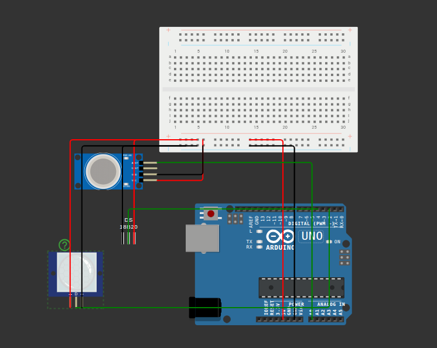

# Simulador en wokwi

## Ponemos los componentes

- Arduino UNO R3 
- Protoboard
- MQ-2
- PIR
- DS18B20 (en el proyecto final usaremos LM35

## Primeras conexiones

### Conectamos alimentación

|Arduino | Protoboard|
|--------|-----------|
|5v| Carril positivo + |
|GND| Carril negativo -|

### Conectamos los 3 sensores

#### Sensor MQ-2

- VCC y GND a protoboard
- AOUT a A0 de arduino

---

#### Sensor PIR

- VCC y GND a protoboard
- OUT a Pin digital 2 de arduino

---

#### Sensor DS18B20

- VCC y GND a protoboard
- DQ a Pin digital 2 de arduino

Si fuese el LM35

- Vout a A1 de arduino

---

### Testeo

Testeamos sensor por sensor para separar posibles fallas.

#### MQ-2

```c++

const int PIN_GAS = A0;

void setup() {
  Serial.begin(9600);
  }

  void loop() {
    int valorGas = analogRead(PIN_GAS);

      Serial.print("Gas: ");
        Serial.println(valorGas);

          delay(1000);
          }

```

Devuelve por terminal
```
  Gas: 907
  Gas: 907
  Gas: 907
  Gas: 907
```

Que el monitor serie muestre 907 de forma constante ya nos sirve como comprobación inicial de que el programa está leyendo un valor del pin A0.

---

#### DS18B20

Este usa digital 1-Wire por lo que hay que agregar algunas librerias aparte.

- OneWire
- DallasTemperature

```c++

#include <OneWire.h>
#include <DallasTemperature.h>

const int PIN_TEMP = 4;

OneWire oneWire(PIN_TEMP);      \\ configura la comunicacion por el pin 4
DallasTemperature sensorTemp(&oneWire);

void setup() {
  Serial.begin(9600);
    sensorTemp.begin();     \\ inicializa la biblioteca del sensor

      Serial.println("Prueba del DS18B20");
      }

      void loop() {
        sensorTemp.requestTemperatures();       \\ solicita una medicion

          float temperatura = sensorTemp.getTempCByIndex(0);        \\obtiene la temperatura del primer snesor detectado

            Serial.print("Temperatura: ");      \\ muestra el resultado
              Serial.print(temperatura);
                Serial.println(" °C");

                  delay(1000);
                  }

```

Devuelve por monitor:
```
Prueba del DS18B20
Temperatura: 22.00 °C
Temperatura: 22.00 °C
Temperatura: 22.00 °C
Temperatura: 22.00 °C
Temperatura: 22.00 °C
```

Esto nos indica que el Arduino se está comunicando con el sensor y está recibiendo una lectura de temperatura válida.

¿Qué comprobamos?
- [x] El sensor está alimentado.
- [x] La comunicación digital por el pin 4 funciona.
- [x] Las bibliotecas OneWire y DallasTemperature están funcionando.
- [x] El Arduino obtiene y muestra la temperatura en grados Celsius.

Que se repita 22.00 °C es normal si la temperatura configurada en el simulador no cambia.

---

#### PIR 


```c++

const int PIN_PIR = 2;

void setup() {
  Serial.begin(9600);

    pinMode(PIN_PIR, INPUT);        // configura el pin 2 como entrada

      Serial.println("Prueba del sensor PIR");
      }

      void loop() {
        int movimiento = digitalRead(PIN_PIR);      // lee el estado digital del sensor

          if (movimiento == HIGH) {     // significa q el PIR esta enviando una señal activa
              Serial.println("Movimiento detectado");
                } else {
                    Serial.println("Sin movimiento");
                      }

                        delay(500);     // espera medio segundo entre lecturas
                        }
```

Devuelve por pantalla
```
Prueba del sensor PIR
Sin movimiento
Sin movimiento
Sin movimiento
Sin movimiento
Sin movimiento
```

El Arduino está leyendo el pin digital 2 y recibe LOW, que nuestro programa interpreta como “Sin movimiento”

El simulador limita para poder testear si el PIR también detecta `HIGH`


---

## Testeo Integrado


Probamos todo junto con un codigo mas compacto



El codigo:

```c++
#include <OneWire.h>
#include <DallasTemperature.h>

// Pines de los sensores
const int PIN_GAS = A0;
const int PIN_TEMP = 4;
const int PIN_PIR = 2;

// Umbrales provisionales de simulación
const int GAS_PREALARMA = 400;
const int GAS_ALARMA = 700;

const float TEMP_PREALARMA = 40.0;
const float GAS_ALARMA = 60.0;

// Comunicación con el DS18B20
OneWire onreWire(PIN_TEMP);
DallasTemperature sensorTemp(&oneWire);

// Variables de medición
int valorGas = 0;
float temperatura = 0.0;
int movimiento = LOW;

// Estado del sistema
enum Estado {
    NORMAL,
    PREALARMA,
    ALARMA
};

Estado estadoActual = NORMAL;

// Declaraciones de funciones
void leerSensores();
void determinarEstado();
void mostrarDatos();

//////////

void setup(){
    Serial.begin(9600);

    pinMode(PIN_PIR, INPUT);
    sensorTemp.begin();

    Serial.println("Sistema de monitoreo ambiental");
}

//////////

void loop(){
    leerSensores();
    determinarEstado();
    mostrarDatos();

    delay(1000);
}


void leerSensores(){
    // Lee el MQ-2
    valorGas = analogRead(PIN_GAS);

    // lee el DS18B20
    sensorTemp.requestTemperatures();
    temperatura = sensorTemp.getTempCByIndex(0);

    // lee el PIR
    movimiento = digitalRead(PIN_PIR):
}


void determinarEstado() {
    if(valorGas >= GAS_ALARMA || temperatura >= TEMP_ALARMA){
        estadoActual = ALARMA;
    }
    else if (valorGas >= GAS_PREALARMA || temperatura >= TEMP_PREALARMA){
        estadoActual = PREALARMA;
    }
    else {
        estadoActual = NORMAL;
    }
}

void mostrarDatos(){
    Serial.print("Gas: ");
    Serial.print(valorGas);

    Serial.print(" | Temperatura: ");
    Serial.print(temperatura);
    Serial.print(" C°");

    Serial.print(" | Movimiento: ");
    if(movimiento == HIGH){
        Serial.print("DETECTADO");
    } else{
        Serial.print("NO detectado");
    }

    Serial.printf(" | Estado: "):

    switch (estadoActual){
        case NORMAL:
            Serial.println("NORMAL");
            break;

        case PREALARMA:
            Serial.println("PREALARMA");
            break;

        case ALARMA:
            Serial.println("ALARMA");
            break;
    }
}

```

Devuelve por terminal:

```
Sistema de monitoreo ambiental
Gas: 907 | Temperatura: 22.00 C | Movimiento: NO DETECTADO | Estado: ALARMA
Gas: 907 | Temperatura: 22.00 C | Movimiento: NO DETECTADO | Estado: ALARMA
```


Alterando los parametros:

```
Sistema de monitoreo ambiental
Gas: 907 | Temperatura: 34.81 C | Movimiento: NO DETECTADO | Estado: PREALARMA
Gas: 907 | Temperatura: 34.81 C | Movimiento: NO DETECTADO | Estado: PREALARMA
Gas: 907 | Temperatura: 34.81 C | Movimiento: NO DETECTADO | Estado: PREALARMA
Gas: 907 | Temperatura: 34.81 C | Movimiento: DETECTADO | Estado: PREALARMA
Gas: 907 | Temperatura: 34.81 C | Movimiento: DETECTADO | Estado: PREALARMA
Gas: 907 | Temperatura: 34.81 C | Movimiento: DETECTADO | Estado: PREALARMA
Gas: 907 | Temperatura: 34.81 C | Movimiento: DETECTADO | Estado: PREALARMA
Gas: 907 | Temperatura: 34.81 C | Movimiento: DETECTADO | Estado: PREALARMA
Gas: 907 | Temperatura: 34.81 C | Movimiento: NO DETECTADO | Estado: PREALARMA
Gas: 907 | Temperatura: 34.81 C | Movimiento: NO DETECTADO | Estado: PREALARMA
Gas: 907 | Temperatura: 34.81 C | Movimiento: NO DETECTADO | Estado: PREALARMA
Gas: 907 | Temperatura: 34.81 C | Movimiento: NO DETECTADO | Estado: PREALARMA
Gas: 907 | Temperatura: 34.81 C | Movimiento: NO DETECTADO | Estado: PREALARMA
Gas: 994 | Temperatura: 34.81 C | Movimiento: NO DETECTADO | Estado: ALARMA
Gas: 995 | Temperatura: 34.81 C | Movimiento: NO DETECTADO | Estado: ALARMA
Gas: 995 | Temperatura: 34.81 C | Movimiento: NO DETECTADO | Estado: ALARMA
Gas: 995 | Temperatura: 34.81 C | Movimiento: NO DETECTADO | Estado: ALARMA
Gas: 746 | Temperatura: 34.81 C | Movimiento: NO DETECTADO | Estado: PREALARMA
Gas: 514 | Temperatura: 34.81 C | Movimiento: NO DETECTADO | Estado: PREALARMA
Gas: 514 | Temperatura: 34.81 C | Movimiento: NO DETECTADO | Estado: PREALARMA
Gas: 514 | Temperatura: 34.81 C | Movimiento: NO DETECTADO | Estado: PREALARMA
Gas: 514 | Temperatura: 34.81 C | Movimiento: NO DETECTADO | Estado: PREALARMA
Gas: 342 | Temperatura: 34.81 C | Movimiento: NO DETECTADO | Estado: NORMAL
Gas: 342 | Temperatura: 34.81 C | Movimiento: NO DETECTADO | Estado: NORMAL
Gas: 342 | Temperatura: 34.81 C | Movimiento: NO DETECTADO | Estado: NORMAL
Gas: 342 | Temperatura: 34.81 C | Movimiento: NO DETECTADO | Estado: NORMAL
Gas: 342 | Temperatura: 78.69 C | Movimiento: NO DETECTADO | Estado: ALARMA
Gas: 342 | Temperatura: 78.69 C | Movimiento: NO DETECTADO | Estado: ALARMA
Gas: 342 | Temperatura: 78.69 C | Movimiento: NO DETECTADO | Estado: ALARMA
Gas: 342 | Temperatura: 65.31 C | Movimiento: NO DETECTADO | Estado: ALARMA
Gas: 342 | Temperatura: 59.31 C | Movimiento: NO DETECTADO | Estado: PREALARMA
Gas: 342 | Temperatura: 59.31 C | Movimiento: NO DETECTADO | Estado: PREALARMA
Gas: 342 | Temperatura: 59.31 C | Movimiento: NO DETECTADO | Estado: PREALARMA
Gas: 342 | Temperatura: 38.50 C | Movimiento: NO DETECTADO | Estado: NORMAL
Gas: 342 | Temperatura: -127.00 C | Movimiento: NO DETECTADO | Estado: NORMAL
Gas: 342 | Temperatura: 29.19 C | Movimiento: NO DETECTADO | Estado: NORMAL
Gas: 342 | Temperatura: 29.19 C | Movimiento: NO DETECTADO | Estado: NORMAL
Gas: 342 | Temperatura: 29.19 C | Movimiento: NO DETECTADO | Estado: NORMAL
Gas: 342 | Temperatura: 29.19 C | Movimiento: DETECTADO | Estado: NORMAL
Gas: 342 | Temperatura: 29.19 C | Movimiento: DETECTADO | Estado: NORMAL
Gas: 342 | Temperatura: 29.19 C | Movimiento: DETECTADO | Estado: NORMAL
```


---


